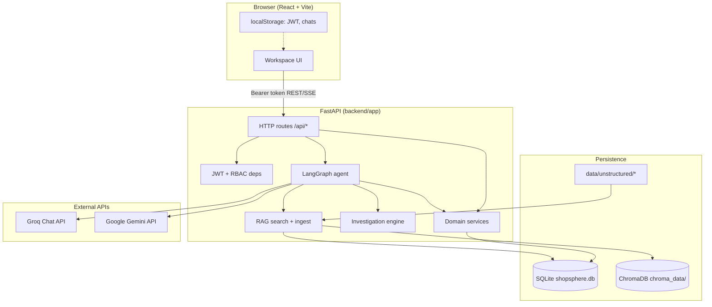
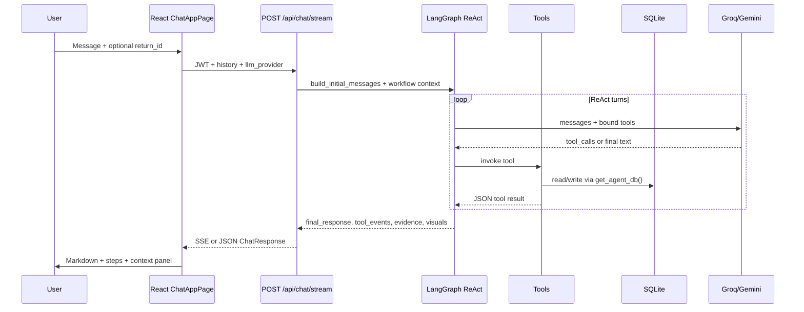
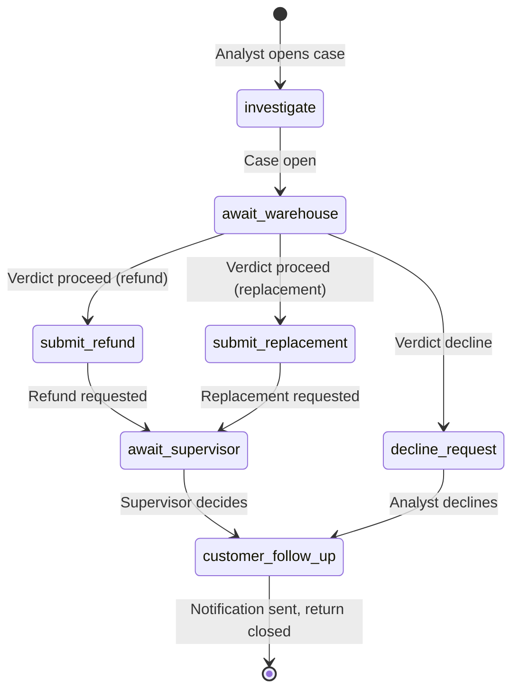
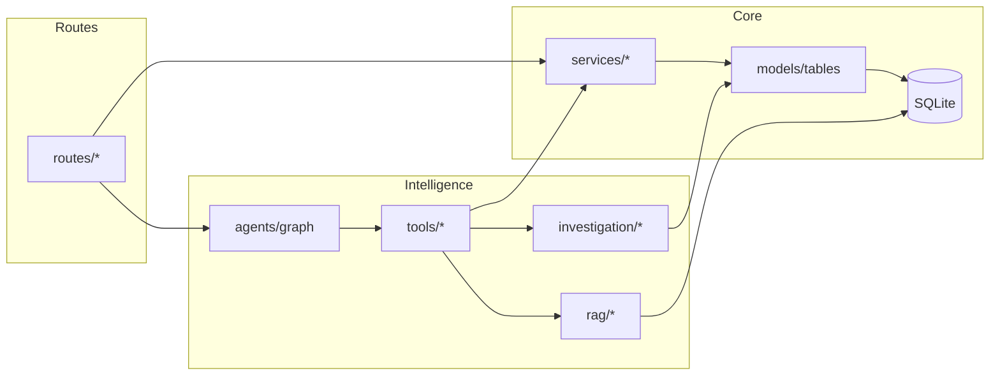

# ShopSphere — Technical Architecture

This document is the **technical architecture reference** for the ShopSphere AI Returns & Product Recovery Agent. It describes how the system works under the hood: components, data flows, modules, and packages. For product overview, demo accounts, and quick start, see [`README.md`](README.md). For the multi-persona returns handoff, see [`docs/WORKFLOW.md`](docs/WORKFLOW.md).

---

## 1. System purpose (technical view)

The platform is a **full-stack demo** of governed retail returns operations:

| Concern | Implementation |
|--------|----------------|
| **Source of truth** | SQLite (`backend/shopsphere.db`) — orders, returns, inspections, cases, refunds, workflow state |
| **Unstructured knowledge** | Files under `data/unstructured/` + rows in `document_metadata` + vector index in **ChromaDB** (`chroma_data/`) |
| **Deterministic logic** | Investigation engine, policy evaluation, recovery optimizer, monitoring rules, workflow classifiers |
| **Conversational layer** | **LangGraph** ReAct agent with **Groq** or **Gemini**; tools call services/SQL/RAG |
| **Governance** | JWT auth, role-based API permissions, role-filtered agent tools, submit → approve → execute for consequential actions |
| **UI** | React (Vite) workspace: chat, persona dashboards, data browser, monitoring |

Nothing invents return facts: the LLM **orchestrates tools** that read or write the database and search documents.

---

## 2. High-level architecture



### 2.1 Request paths (two main interaction modes)

**A. REST / dashboard / forms** — Browser calls FastAPI routes; services enforce rules and write SQLite.

**B. Agent chat** — `POST /api/chat` or `POST /api/chat/stream` runs LangGraph; each tool uses a **thread-local SQLAlchemy session** (`agents/context.py`) so parallel tool calls do not share the FastAPI request session.



---

## 3. Repository layout

```
agentic_chatbot/
├── ARCHITECTURE.md          ← this file (technical architecture)
├── README.md                ← product README, quick start, personas
├── .env.example             ← API keys, DB URL, CORS, LLM settings
├── backend/                 ← Python FastAPI application
│   ├── app/                 ← runtime code (see §4)
│   ├── alembic/             ← schema migrations
│   ├── tests/               ← pytest suite
│   ├── scripts/             ← probes, E2E Gemini flows
│   ├── requirements.txt
│   └── shopsphere.db        ← created locally (gitignored)
├── frontend/                ← React SPA (see §5)
├── data/                    ← synthetic seeds + unstructured corpus (see §6)
├── scripts/                 ← load DB, ingest RAG, eval, monitoring CLI
└── docs/                    ← workflow notes, unstructured data guides
```

---

## 4. Backend (`backend/app`)

Entry point: **`main.py`** — creates FastAPI app, CORS, mounts `api_router` at `/api`, lifespan hooks:

- Ensures SQLite/Chroma directories exist
- Runs **Alembic** `upgrade head` (best-effort)
- Bootstraps **demo users** via `services/demo_users.py`
- Optional background **monitoring** worker when `MONITORING_AUTO_RUN=true`

Configuration: **`config.py`** — Pydantic settings from `.env` (paths, JWT, Groq/Gemini, embedding model, action flags, monitoring interval).

### 4.1 Package map

| Package / area | Role |
|----------------|------|
| **`routes/`** | HTTP API surface (thin controllers) |
| **`schemas/`** | Pydantic request/response models |
| **`services/`** | Business logic, queues, workflows, refunds, cases, timeline, monitoring |
| **`models/`** | `enums.py` domain strings; `tables.py` SQLAlchemy ORM |
| **`database/`** | Engine, sessions, `Base`, UTC helpers, startup migrate helper |
| **`security/`** | Password hashing, JWT tokens, `CurrentUser`, `permissions.py` role sets |
| **`agents/`** | LangGraph graph, prompts, tool RBAC filter, streaming, evidence, visuals |
| **`tools/`** | LangChain `@tool` wrappers (SQL, docs, actions, workflow, portfolio, recovery) |
| **`investigation/`** | Deterministic 12-check investigation + policy + signals |
| **`rag/`** | Extract, chunk, embed, Chroma store, semantic search, ingest pipeline |
| **`llm/`** | Groq (incl. key rotation), Gemini, rate limits, context window trimming, router |
| **`synthetic/`** | Generate/load/validate demo structured data + ground truth |
| **`eval/`** | Ground-truth eval harness and tool registry for acceptance tests |
| **`documents/`** | Document loading helpers used by preview/render paths |

### 4.2 HTTP routes (`routes/` → `/api`)

| Module | Prefix (typical) | Responsibility |
|--------|------------------|----------------|
| `health.py` | `/health` | Liveness, DB/RAG/LLM configuration hints |
| `auth.py` | `/auth` | Login → JWT |
| `returns.py` | `/returns` | Return CRUD-ish reads, timeline, receive, inspections, verdict, decline, workflow |
| `investigation.py` | `/returns/{id}/investigation` | Deterministic investigation report JSON |
| `orders.py` | `/orders` | Order detail |
| `products.py` | `/products` | Product summary |
| `cases.py` | `/cases` | Investigation cases: create, assign, resolve, close |
| `refunds.py` | `/refunds` | List, request, approve, execute |
| `replacements.py` | `/replacements` | Replacement requests and supervisor decision |
| `notifications.py` | `/notifications` | Customer notification drafts and send |
| `recovery.py` | `/recovery` | Recovery options, recommendation, tasks |
| `actions.py` | `/actions` | Generic action request lifecycle |
| `approvals.py` | `/approvals` | Unified supervisor approval queue |
| `dashboard.py` | `/dashboard` | Legacy summary + **`/dashboard/workspace`** persona KPIs and queues |
| `monitoring.py` | `/monitoring` | Alerts, run checks, acknowledge |
| `chat.py` | `/chat` | Agent chat JSON + **SSE stream** |
| `documents.py` | `/documents` | Preview HTML/file for indexed docs |
| `data_browser.py` | `/data-browser` | Read-only table browser + document catalog |
| `agent.py` | `/agent` | Public capability catalog for UI |
| `llm.py` | `/llm` | Configured providers for UI picker |

All protected routes use **`get_current_user`** (`security/deps.py`); many services additionally check **`permissions.py`** role frozensets.

### 4.3 Domain services (`services/`) — selected modules

Services are the **authoritative business layer** (used by both REST and tools).

| Module | Function |
|--------|----------|
| `return_workflow.py` | **`build_return_workflow_snapshot`** — single workflow truth for agent, APIs, dashboards |
| `analyst_queue.py` | Classify return stage for analyst; build analyst work queue + KPIs |
| `warehouse_queue.py` | Warehouse receive / inspect / verdict queue |
| `supervisor_queue.py` | Approval queue (refunds, replacements, action requests) |
| `workspace_dashboard.py` | Assembles persona-specific **`GET /dashboard/workspace`** payload |
| `warehouse_handoff.py` | Receipt + handoff status |
| `handoff.py` | Warehouse verdict read helpers |
| `cases.py` / `case_transitions.py` | Case lifecycle |
| `refunds.py` / `refundable.py` | Refund request, approve, execute, amount calculation |
| `replacements.py` | Replacement flow + stock checks |
| `approvals.py` | Approval listing and decisions (datetime-aware) |
| `actions.py` / `action_policy.py` | ActionRequest submit/approve/execute |
| `investigation` (route) delegates to `investigation/investigation.py` | |
| `recovery.py` / `recovery_optimizer.py` / `recovery_tasks.py` | Recovery economics and tasks |
| `timeline.py` / `return_events.py` | Chronological return journey |
| `monitoring.py` / `alerts.py` / `escalations.py` | Scheduled operational checks |
| `audit.py` | Audit log writes |
| `notifications.py` | Customer email drafts (no real SMTP) |
| `evidence_requests.py` | Evidence request entities |
| `return_status.py` | Return status transitions |
| `data_browser.py` | Safe read-only SQL table browsing |
| `document_preview.py` / `document_render.py` | Docx/PDF preview for UI |
| `health.py` | Health check aggregation |
| `demo_users.py` | Seed workspace users |
| `dashboard.py` | Older aggregate dashboard metrics |
| `decision_passport.py` | Legacy passport persistence (UI/API largely removed; table may remain) |
| `queries.py` | Shared query helpers |
| `errors.py` | Service error types |
| `warranty.py` / `inventory.py` / `inspections.py` | Supporting domain |
| `issue_types.py` | Issue type coercion |

### 4.4 Data model (`models/tables.py`)

SQLite tables (Alembic-managed). Core commerce → returns → ops:

| Table | Purpose |
|-------|---------|
| `customers`, `suppliers`, `products`, `orders`, `order_items`, `product_units`, `deliveries` | Commerce graph |
| `returns`, `return_shipments`, `inspections` | Returns pipeline |
| `refunds`, `replacement_requests`, `warehouse_verdicts`, `customer_notifications` | Persona workflow outcomes |
| `investigation_cases`, `case_notes`, `evidence_requests` | Investigations |
| `recovery_options`, `recovery_tasks`, `inventory_dispositions` | Product recovery |
| `action_requests` | Agent/API gated actions |
| `return_events` | Timeline events |
| `audit_logs` | Audit trail |
| `document_metadata` | Index of unstructured files |
| `users` | Login accounts (hashed passwords) |
| `system_alerts`, `monitoring_runs`, `escalations` | Oversight |
| `warranty_claims`, `decision_passports` | Extended / legacy features |

Enums live in **`models/enums.py`** (`UserRole`, `ReturnStatus`, `ActionType`, `DocumentType`, etc.).

### 4.5 Investigation engine (`investigation/`)

| File | Role |
|------|------|
| `investigation.py` | Runs **12 deterministic checks**; produces structured report + recommended outcome |
| `policy.py` | Policy window / category rules (`PolicyEvaluation`) |
| `signals.py` | Primary signal derivation for narrative consistency |
| `evidence_summary.py` | Summaries for UI/agent evidence |

Exposed to the agent via tool **`run_return_investigation`** and HTTP **`GET .../investigation`**.

### 4.6 RAG pipeline (`rag/`)

| Stage | Module | Behavior |
|-------|--------|----------|
| Extract | `extract.py` | PDF, DOCX, EML, text → plain text |
| Chunk | `chunk.py` | Split for embedding |
| Embed | `embeddings.py` | `sentence-transformers` (config: `EMBEDDING_MODEL`) |
| Store | `store.py` | Chroma persistent client at `chroma_path` |
| Search | `search.py` | Metadata filters + vector query; joins `document_metadata` |
| Ingest | `ingest.py` | Full reindex from DB rows (used by `scripts/ingest_documents.py`) |

Document tools in **`tools/doc_tools.py`** call search helpers and return compact JSON for the LLM.

### 4.7 LLM layer (`llm/`)

| Module | Role |
|--------|------|
| `router.py` | Select Groq vs Gemini; `get_chat_model()` |
| `groq.py` / `groq_rotating.py` | Multi-key Groq client + RPM |
| `gemini.py` / `gemini_openai_compat.py` | Gemini chat |
| `guarded.py` | Wrapper for retries/backoff |
| `rate_limit.py` / `retry.py` | Client-side throttling |
| `context_window.py` | Trim messages to token budget |

Chat requests pass **`llm_provider`** from the UI (`LlmContext`); default from `LLM_PROVIDER` in `.env`.

### 4.8 Agent runtime (`agents/`)

| Module | Role |
|--------|------|
| `graph.py` | **`ALL_TOOLS`**, `create_react_agent`, `run_agent_chat`, `stream_agent_chat`, SSE encoding, return ID inference |
| `tool_access.py` | **`filter_tools_for_role`** — maps tool names → allowed `UserRole` sets |
| `prompts.py` | System prompt + per-role behavior |
| `context.py` | Per-thread `scoped_session`; user in LangGraph config |
| `history.py` | Trim conversation history for token budget |
| `steps.py` | Agent step timeline for UI |
| `operator_response.py` | Final markdown formatting |
| `document_citations.py` | Enrich tool events with doc sources |
| `evidence.py` | Structured + document supporting evidence |
| `visuals.py` | Optional UI visuals from tool results |
| `capabilities.py` | Static capability catalog |
| `limits.py` | Turn/tool limits |

**Tool bundles** (`tools/`):

| File | Tools (summary) |
|------|-----------------|
| `sql_tools.py` | `get_return_workflow_status`, return/order/product/delivery/inspection/refund/history/serial/shipment, `calculate_refundable_amount` |
| `doc_tools.py` | Policy, complaints, inspections, warranty, supplier, support comms, refurbishment search; `resolve_applicable_policy` |
| `investigation_tools.py` | `run_return_investigation` |
| `workflow_tools.py` | Timeline, inconsistencies, complaint patterns, warehouse handoff, receipt, inspection, verdict, decline, replacement decision, notifications |
| `portfolio_tools.py` | List returns/refunds/cases/actions, summaries, monitoring overview |
| `recovery_tools.py` | `get_recovery_options`, `get_recovery_recommendation` |
| `action_tools.py` | Submit cases, refunds, replacements, recovery tasks, approvals, execute, assign, evidence |
| `compact.py` | JSON size limits for tool outputs |

### 4.9 Synthetic data (`synthetic/`)

Used by **`scripts/load_database.py`**:

- `generator.py` / `bulk.py` / `catalog.py` / `scenarios.py` — build dataset bundle
- `loader.py` — insert into SQLite
- `validate.py` — post-load integrity checks
- `ground_truth.py` — write expected decisions under `data/ground_truth/`

### 4.10 Eval (`eval/`)

- `harness.py` — run scenarios against expected tools/decisions
- `registry.py` — ties into agent tool names for acceptance tests

`scripts/run_ground_truth_eval.py` drives batch eval.

### 4.11 Database lifecycle

| Piece | Location |
|-------|----------|
| Migrations | `backend/alembic/versions/*.py` |
| Startup migrate | `database/migrate.py` |
| Session factory | `database/session.py` → `get_db` dependency |
| Engine | `database/connection.py` |

---

## 5. Frontend (`frontend/src`)

Stack: **React 19**, **React Router**, **Vite**, **Tailwind**, **lucide-react**, **react-markdown**, **docx-preview**.

### 5.1 Routing (`App.tsx`)

| Path | Page | Notes |
|------|------|-------|
| `/` | Redirect | Login or persona home |
| `/login` | `LoginPage` | Demo accounts |
| `/workspace` | `ChatAppPage` | Main agent UI |
| `/workspace/dashboard` | `DashboardPage` | Analyst / warehouse / supervisor queues |
| `/workspace/data` | `DataBrowserPage` | SQLite + document catalog |
| `/workspace/monitoring` | `MonitoringPage` | Alerts (supervisor-oriented) |
| `/workspace/tasks` | `TasksPage` | Recovery/tasks view |
| `/workspace/approvals` | Redirect → dashboard | Legacy URL |

`ProtectedRoute` requires stored JWT.

### 5.2 State and API

| Area | Files |
|------|-------|
| Auth | `context/AuthContext.tsx`, `api/client.ts` (`setAuth`, Bearer on fetch) |
| LLM picker | `context/LlmContext.tsx`, `GET /api/llm/providers` |
| Toasts | `context/ToastContext.tsx` |
| API types | `api/types.ts` |
| HTTP client | `api/client.ts` — chat stream, returns, dashboard, data-browser, etc. |

### 5.3 Chat workspace

| Component | Role |
|-----------|------|
| `ChatAppPage.tsx` | Conversations in **localStorage** per username; streaming chat |
| `ChatSidebar.tsx` | Threads, return search, links to queue + **Database** |
| `ChatComposer.tsx` / `MessageList.tsx` | Input and transcript |
| `ContextPanel.tsx` | Pinned return: investigation, timeline, workflow shortcuts |
| `ContextPanelWorkflow.tsx` | Supervisor/warehouse shortcuts |
| `ChatHeader.tsx` / `WorkspaceNav.tsx` | Top nav: Queue, Agent, Database |
| `StarterPrompts.tsx` / `lib/starterPrompts.ts` | Role-based prompts |
| `lib/chats.ts` | Conversation persistence |
| `lib/agentSteps.ts` / `lib/toolLabels.ts` | Tool step UI |
| `lib/personaWorkspace.ts` | Which persona gets dashboard home vs agent home |

### 5.4 Dashboards

| Component | Persona |
|-----------|---------|
| `AnalystDashboard.tsx` / `AnalystWorkQueue.tsx` | Returns analyst |
| `WarehouseDashboard.tsx` / `WarehouseWorkQueue.tsx` | Warehouse manager |
| `SupervisorDashboard.tsx` / `SupervisorApprovalsQueue.tsx` | Supervisor approvals + KPIs |
| `DashboardKpiGrid.tsx` | Shared KPI layout |

Data source: **`GET /api/dashboard/workspace`**.

### 5.5 Data browser

| Component | Role |
|-----------|------|
| `DataBrowserPage.tsx` | Overview, DB path warning, table/doc tabs |
| `StructuredDataPanel.tsx` | Paginated table rows |
| `DocumentsPanel.tsx` / `BrowserDocumentPreview.tsx` | Document list + preview |

### 5.6 Landing / auth

`components/landing/*`, `pages/LoginPage.tsx`, `lib/demoAccounts.ts`.

---

## 6. Data directory (`data/`)

| Path | Contents |
|------|----------|
| `data/unstructured/complaints/` | `.eml`, `.txt` customer complaints |
| `data/unstructured/communications/` | Support email threads |
| `data/unstructured/inspections/` | Warehouse inspection PDFs |
| `data/unstructured/policies/` | Return policy PDF/DOCX by category |
| `data/unstructured/warranties/` | Warranty documents |
| `data/unstructured/refurbishment/` | Refurb guidelines |
| `data/unstructured/supplier_reports/` | Supplier defect reports |
| `data/ground_truth/` | `expected_decisions.json`, `expected_tool_actions.json`, manifests for eval |

Structured rows are **not** shipped as SQL in git; they are generated into SQLite by **`scripts/load_database.py`**.

---

## 7. Scripts (operations)

### 7.1 Repo root `scripts/`

| Script | Purpose |
|--------|---------|
| `load_database.py` | Generate synthetic bundle → load SQLite → validate |
| `ingest_documents.py` | Chunk/embed all `document_metadata` → Chroma |
| `seed_users.py` | Demo login users |
| `load_document_metadata.py` | Register unstructured files in DB |
| `generate_structured_data.py` / `generate_unstructured_documents.py` | Regenerate corpora |
| `validate_data.py` / `audit_structured_data.py` / `compare_scenarios_to_db.py` | Data QA |
| `run_monitoring.py` | CLI monitoring run |
| `sync_return_events.py` | Timeline/event repair |
| `run_ground_truth_eval.py` | Agent eval harness |
| `run_migrations.py` | Alembic helper |
| `unstructured/*` | Builders for synthetic PDFs/emails/policies |

### 7.2 `backend/scripts/`

E2E and LLM probes: `e2e_gemini_persona_flow.py`, `e2e_three_personas.py`, `probe_gemini_*.py`.

---

## 8. Persona workflow (cross-cutting)

Three primary demo personas share **one database**. Stage classification is centralized so the agent and dashboards stay aligned.



**Read paths:** `GET /api/returns/{id}/workflow`, tool `get_return_workflow_status`, analyst/warehouse/supervisor queues on **`/api/dashboard/workspace`**.

**Write paths:** REST on `returns`, `cases`, `refunds`, `replacements`, `notifications`, or agent **workflow/action tools** (same services underneath).

---

## 9. Security model

| Layer | Mechanism |
|-------|-----------|
| Transport | Local dev HTTP; CORS allowlist for Vite origin |
| Authentication | `POST /api/auth/login` → JWT (`security/tokens.py`) |
| Authorization | `permissions.py` role sets on routes; `tool_access.py` on agent tools |
| Read-only mode | `ACTIONS_DISABLED=true` blocks consequential executes |
| Data browser | Hides `password_hash`; table allowlist from SQLAlchemy metadata |
| Documents | `access_level` on metadata; doc tools may filter by role |

Roles (enum `UserRole`): `returns_analyst`, `warehouse_manager`, `returns_supervisor`, `administrator` (and legacy support/admin aliases in older docs — check `demo_users.py` for what is seeded today).

---

## 10. Observability and quality

| Mechanism | Location |
|-----------|----------|
| Structured logging | `config.log_level`, uvicorn |
| Audit log | `audit_logs` table + `services/audit.py` |
| Monitoring alerts | `system_alerts`, `services/monitoring.py` |
| Tests | `backend/tests/` (API, workflow, agent, RAG, refunds, queues) |
| Ground truth eval | `data/ground_truth` + `eval/harness.py` |

---

## 11. Environment variables (essential)

See [`.env.example`](.env.example). Highlights:

| Variable | Effect |
|----------|--------|
| `DATABASE_URL` | SQLite path (default `sqlite:///./shopsphere.db` under `backend/`) |
| `CHROMA_PATH` | Vector store directory |
| `GROQ_API_KEY`, `GROQ_MODEL`, `GROQ_API_KEYS` | Groq chat |
| `GEMINI_API_KEY`, `GEMINI_MODEL` | Gemini chat |
| `JWT_SECRET_KEY` | Token signing |
| `CORS_ORIGINS` | Frontend origins |
| `ACTIONS_DISABLED` | Kill-switch for writes |
| `MONITORING_AUTO_RUN` | Background monitoring loop in `main.py` |
| `EMBEDDING_MODEL` | RAG embeddings |

---

## 12. Typical local boot order

1. `cd backend` → venv → `pip install -r requirements.txt`
2. Copy `.env` from `.env.example`
3. `alembic upgrade head`
4. From repo root: `python scripts/load_database.py`
5. `python scripts/ingest_documents.py` (after metadata load if needed)
6. `python scripts/seed_users.py` (if not auto-created on startup)
7. `uvicorn app.main:app --reload --host 127.0.0.1 --port 8000`
8. `cd frontend` → `npm install` → `npm run dev`
9. Confirm data: [http://localhost:5173/workspace/data](http://localhost:5173/workspace/data)

---

## 13. Architecture diagram — module dependencies (backend)



---

## 14. Related documentation

| Document | Topic |
|----------|--------|
| [`README.md`](README.md) | Product value, personas, quick start |
| [`docs/WORKFLOW.md`](docs/WORKFLOW.md) | Step-by-step persona handoff + API rules |
| [`docs/UNSTRUCTURED_DATA.md`](docs/UNSTRUCTURED_DATA.md) | Document corpus |
| [`REFUND_PERSONA_FLOW.md`](REFUND_PERSONA_FLOW.md) | Refund walkthrough (if present) |
| [`PERSONAS.md`](PERSONAS.md) | Persona comparison (if present) |
| [`questions.md`](questions.md) | Sample prompts |

---

## 15. Version note

This architecture describes the repository as an **internal demonstration** of ShopSphere Retail. External integrations (real OMS, payment rails, email delivery) are intentionally stubbed: customer addresses use safe domains, and “send notification” updates database state and audit only.
